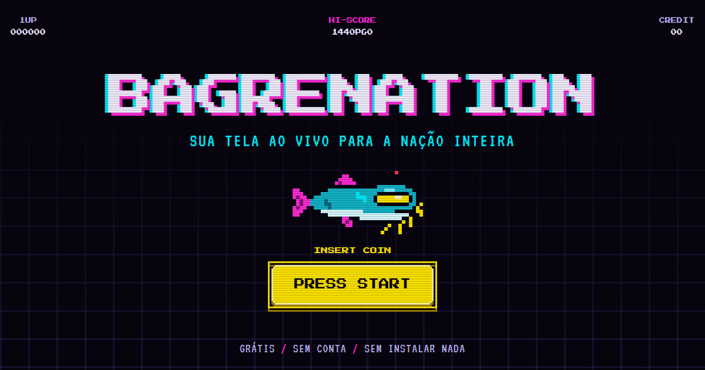

# BAGRENATION



Chat de voz e compartilhamento de tela com um ID de 6 caracteres, direto no navegador. Sem conta e sem instalar nada: entrou na sala, entrou no canal de voz, e qualquer um pode mostrar a tela (ou a janela, a guia, o jogo) com o áudio junto.

**Abrir:** https://alissonlittig.github.io/bagrenation/

## Como usar

1. Aperte **Press Start**, escolha um avatar se quiser, clique em **Criar sala** e passe o ID (ex.: `K7Q-M4P`) para quem vai assistir. Ele não tem 0, O, 1, I nem L, então dá para ditar por voz. Se preferir, **copiar link** também funciona.
2. Quem vai entrar digita o ID. Se a sala não existir, o BAGRENATION avisa e ninguém sai da sala onde está.
3. O navegador pede o microfone: aceitou, já está falando com a sala. Sem microfone (ou negando), você só ouve.
4. Clique em **Compartilhar tela** e escolha a guia, a janela ou o monitor. Para enviar som, marque "Compartilhar áudio" no seletor do navegador.

Mais de uma pessoa pode transmitir ao mesmo tempo na mesma sala.

## O que tem

- **Chat de voz** como um canal de voz: microfone mudo, ensurdecer (corta a sala e o seu microfone), volume separado para cada pessoa, anel verde no avatar de quem está falando, microfone aberto por padrão (detecção de voz com sensibilidade ajustável, se quiser um portão) ou **push-to-talk** com a tecla que você escolher, faixa de estado sempre à vista (conectado, microfone ligado/mudo/sem microfone, quem está falando), escolha de microfone e de saída, teste de microfone com retorno e medidor.
- **Ping e atraso por pessoa**, medidos na conexão real (`getStats`): na lista aparece o ping e o atraso estimado de boca a ouvido; passando o mouse, a conta aberta (rede, buffer, saída de som, perda).
- **Avatares**: 4 bagres em pixel art (clássico, DJ, rei e tóxico) para escolher na entrada e trocar depois; sem escolha, fica a inicial do nome. A escolha fica salva no navegador.
- Tela inteira, janela, guia ou jogo, com áudio estéreo.
- **Sem Discord**: com a opção ligada, o seletor só oferece janela e guia, que levam só o próprio som (o som da tela inteira inclui o Discord). Se o navegador não deixar esconder a tela inteira e ela for escolhida, o BAGRENATION corta o áudio e avisa. O botão de ajuda explica cada caso e como rotear o Discord para outra saída no Windows.
- Medidor do áudio que está saindo e destaque verde na tela que está com som tocando. O som da tela e a voz vão em conexões separadas: dá para baixar um sem mexer no outro.
- Qualidade de 720p/30 até 1440p/60 e prioridade entre fluidez (jogos) e nitidez (texto), trocáveis durante a transmissão.
- Trocar a tela transmitida sem encerrar.
- Volume e mudo separados para cada transmissão; quem transmite pode silenciar o próprio áudio para todos.
- Tela cheia, janela flutuante (picture-in-picture) e modo destaque.
- Números reais de cada transmissão: resolução, quadros por segundo, taxa e latência; quem transmite vê quantos estão assistindo e se o limite é a rede ou o processador.
- Indicador de conexão e reconexão automática.
- A sala continua existindo quando quem criou sai, e o mesmo link segue valendo.
- Chat leve, sem histórico.
- Funciona no celular para falar, ouvir e assistir.
- Sons 8-bit opcionais na interface (desligados por padrão): cliques e teclado mecânico antigo ao digitar.

## Voz: o que está configurado para atraso mínimo e som cheio

| Onde | Ajuste | Para quê |
|---|---|---|
| Caminho | WebRTC direto entre os navegadores (malha), uma conexão só de áudio por pessoa | Nenhum servidor no meio: o atraso é o da rede entre os dois |
| Codec | Opus, 48 kHz, estéreo (`stereo=1; sprop-stereo=1`) | Banda cheia; o padrão do navegador é mono |
| Taxa | até 128 kb/s (`maxaveragebitrate=128000` + teto no envio) | O padrão é ~32 kb/s |
| Quadro | 10 ms (`ptime=10; minptime=10`), ~100 pacotes por segundo | Metade do atraso de empacotamento do padrão (20 ms) |
| Perda | FEC embutido do Opus (`useinbandfec=1`), sem DTX (`usedtx=0`) | Recupera pacote perdido sem retransmitir; não corta o som ambiente |
| Reprodução | alvo do buffer de jitter em zero (`jitterBufferTarget = 0`, `playoutDelayHint = 0`) | O navegador segura só o mínimo que a rede exige |
| Fila de envio | prioridade alta para a voz (`priority` e `networkPriority`) | A voz passa na frente do vídeo da tela |
| Captura | 48 kHz, 2 canais e a menor latência que o aparelho der (`latency: 0` como ideal) | Sem conversão de taxa no caminho |
| Filtros | cancelamento de eco e supressão de ruído (com ganho automático) do navegador, **ligáveis** | Ligados por padrão (caixa de som não vira eco). De fone, desligue os dois: o microfone vai cru, com menos atraso |
| Portão | detecção de voz/push-to-talk só ligam e desligam a faixa já negociada | Abrir o microfone não renegocia nada; a medição do nível é uma derivação, fora do caminho do som |

Nada é gravado e nenhum processamento próprio fica no caminho do áudio. Para conferir numa sala aberta, rode no console do navegador `await BAGRENATION.voiceStats()`: mostra o codec negociado, pacotes por segundo, ping, buffer e atraso de cada conexão.

Medido no teste automático (três abas na mesma máquina, microfone simulado): ping de 1 a 3 ms, buffer de jitter entre 30 e 70 ms e atraso estimado total entre 60 e 125 ms. O piso é o buffer mínimo do navegador mais a placa de som; pela internet, some a isso metade do ping entre as duas pessoas.

## Visual

Interface de fliperama cyberpunk em pixel art: tela de abertura "Press Start", HUD, botões que afundam ao clicar, linhas de CRT e falha de sinal no logo. Os ícones 16×16, as molduras em degrau, os avatares e o mascote (um bagre de viseira, com dois quadros de animação) são desenhados em grade de texto dentro de `tools/pixel.py`, que gera o SVG embutido no `index.html`, as molduras do `style.css` e o `favicon.svg`:

```bash
python tools/pixel.py
```

Com `prefers-reduced-motion`, as linhas de CRT, o glitch e as animações são desligados.

## Como funciona

O vídeo e o áudio vão de navegador para navegador por WebRTC, criptografados, sem passar por servidor. O único serviço externo é o servidor público de sinalização do [PeerJS](https://peerjs.com/), usado só para os navegadores se encontrarem.

Cada sala tem um ID de 6 caracteres (31 símbolos, ≈ 887 milhões de combinações) sorteado com gerador criptográfico. Links antigos com código de 10 caracteres continuam valendo. Um dos participantes mantém o "diretório" da sala (a lista de quem está dentro); se ele sai, outro assume automaticamente. Os participantes se ligam em malha, e quem transmite envia uma cópia para cada espectador.

O site é estático: `index.html`, `style.css`, `app.js`, a biblioteca PeerJS (carregada só ao apertar Press Start ou abrir um link de sala) e as fontes, todos servidos do próprio repositório. Não há build.

## Limites

- **Tamanho da sala (malha).** Cada pessoa mantém uma conexão de voz com cada uma das outras e envia a própria voz uma vez por pessoa. Com 128 kb/s, numa sala de N pessoas cada um sobe e desce cerca de (N − 1) × 0,13 Mb/s e decodifica N − 1 vozes. Fica confortável até umas **8 pessoas** e aguenta por volta de 10 a 12 em máquina e rede boas; acima disso o certo é um servidor de mídia (SFU), que este projeto não tem. O teste automático roda com 5 na malha.
- **Sem TURN.** O projeto usa apenas STUN, sem servidor de retransmissão. Se as duas pontas estiverem atrás de CGNAT, NAT simétrico ou rede corporativa, a conexão direta entre aquele par pode não fechar: os dois aparecem na lista e no chat, mas ficam em "conectando a voz…" e não se ouvem (o BAGRENATION avisa depois de duas tentativas). O resto da sala segue normal. A solução é configurar um servidor TURN na constante `ICE` do `app.js`; com TURN a voz passa a ter o atraso do desvio pelo servidor.
- **Push-to-talk só com a guia em foco.** Navegador não recebe teclas com outra janela na frente (jogo em tela cheia, por exemplo). Jogando, use a detecção de voz.
- **Eco sem fone.** Com o cancelamento de eco desligado e som saindo em caixa, a sala ouve o próprio retorno. Deixe ligado ou use fone.
- **Saída de som.** Escolher a saída funciona no Chrome e no Edge; Firefox e Safari tocam na saída padrão do sistema.
- **Upload.** Quem transmite envia uma cópia por espectador. Em 1080p/60 cada cópia pode chegar a 10 Mb/s; para grupos grandes, reduza a qualidade.
- **Áudio.** Chrome e Edge enviam o áudio de uma guia em qualquer sistema e o áudio do sistema inteiro só no Windows. Firefox e Safari não capturam áudio de tela.
- **Celular** não transmite tela (os navegadores móveis não oferecem essa função); fala, ouve e assiste.
- **Quem tem o ID entra.** Não há senha; todo participante aparece na lista da sala. O ID curto é mais fácil de adivinhar que um código longo: para algo sigiloso, não use o BAGRENATION.
- **Sem Discord** não separa aplicativos dentro do som do sistema (nenhum navegador permite isso). Ele funciona escolhendo uma fonte sem o Discord: guia (Chrome/Edge) ou janela (Chrome/Edge recentes, que oferecem o áudio só da janela).
- **Sinalização de terceiros.** O servidor público do PeerJS é gratuito, sem garantia de disponibilidade, e enxerga os identificadores das salas (não o vídeo nem o áudio). Se ele cair, ninguém novo entra; as transmissões abertas continuam.

## Rodar e testar

```bash
python -m http.server 8000        # abra http://localhost:8000
```

O teste de ponta a ponta abre vários navegadores reais com tela e microfone simulados, em dois cenários. **Tela**: 20 etapas (abertura, ID inválido e inexistente recusados, entrada digitando o ID, recarregar sem perder a sala, vídeo e áudio chegando, volume, Sem Discord, chat, duas transmissões, queda de rede, saída de quem criou a sala, celular, menos movimento). **Voz**: 11 etapas com 3 abas falando, 1 sem microfone e 1 celular (avatares, codec e pacotes por segundo negociados, anel de quem fala, mudo, ensurdecer, push-to-talk, sensibilidade, filtros, teste de microfone, volume por pessoa, tela junto com voz, sair e voltar), com o ping e o atraso medidos impressos:

```bash
pip install playwright && playwright install chromium
python tests/test_e2e.py                                   # servidor local
python tests/test_e2e.py https://alissonlittig.github.io/bagrenation/   # site publicado
ONLY=voz python tests/test_e2e.py                           # só o cenário de voz
```

## Origem

O BAGRENATION (antes chamado Telão) nasceu de uma análise do projeto [Streamcord](https://github.com/felipedays/streamcord), que tem a mesma proposta. Aquele repositório não tem licença, então nenhum código foi reaproveitado: tudo aqui foi escrito do zero. A análise completa, com os problemas encontrados e as provas, está em [ANALISE.md](ANALISE.md).

## Licenças

Código sob licença MIT (arquivo `LICENSE`). Inclui [PeerJS 1.5.5](https://github.com/peers/peerjs) (MIT, `vendor/PEERJS-LICENSE.txt`) e as fontes [Press Start 2P](https://fonts.google.com/specimen/Press+Start+2P) e [VT323](https://fonts.google.com/specimen/VT323) (SIL OFL 1.1, `fonts/*-LICENSE.txt`).
