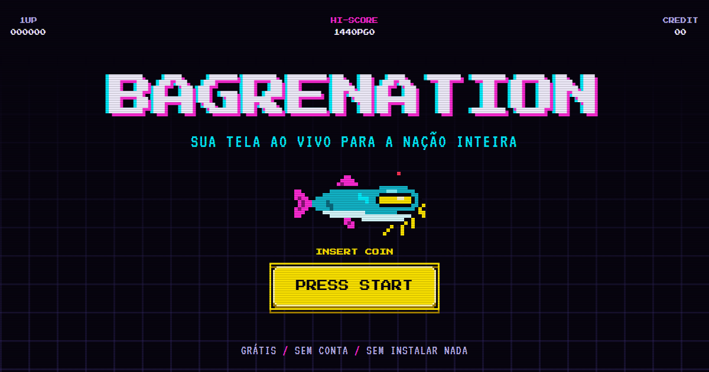

# BAGRENATION



Um servidor fixo, como um servidor do Discord: abriu o BAGRENATION (site ou app), já está lá, vendo quem está online, o **#chat** (com imagem, GIF e vídeo, e o histórico fica) e o **Canal de voz**. Entra no canal com um clique e qualquer um no canal pode mostrar a tela (ou a janela, a guia, o jogo) com o áudio junto. Sem conta.

**Abrir:** https://alissonlittig.github.io/bagrenation/

## Como usar

1. Abra o site (ou o app). Na primeira vez ele pergunta o nome e o avatar; depois abre direto.
2. **#chat**: escreva, ou mande imagem, GIF ou vídeo (botão de imagem, Ctrl+V ou arrastar para o chat; até 25 MB cada, 5 por vez, com prévia antes de enviar). O histórico fica salvo mesmo quando todo mundo sai.
3. **Canal de voz**: clique no canal (ou em **Entrar no canal de voz**). O navegador pede o microfone: aceitou, já está falando. Sem microfone (ou negando), você só ouve. Para sair, o botão vermelho no dock ou em **Voz conectada**.
4. Dentro do canal, **Compartilhar tela** e escolha a guia, a janela ou o monitor. Para enviar som, marque "Compartilhar áudio" no seletor do navegador.

5. **Modo foco** (botão **Retrair laterais** no topo, botão de moldura no dock ou tecla **F**): esconde canais, pessoas online, #chat e barras, e deixa só o canal de voz. **Tela**: a tela compartilhada ocupa tudo (com mais de uma, escolha qual pelo nome ou clicando na miniatura; quem está no canal vira uma faixa de rostos em cima). **Pessoas**: grade grande com quem está no canal, contorno verde em quem fala. **Esc** ou **Sair** volta; mensagem nova no #chat aparece no botão Sair. A escolha fica lembrada. **Retrair chat** (botão no topo ou tecla **C**, com a janela larga) esconde só o chat da direita e deixa canais e pessoas; também fica lembrado.

6. **Mensagens**: passe o mouse numa mensagem (ou botão direito; no celular, toque longo) para **reagir** com emoji, **responder** (a citação leva até a mensagem original), **copiar o texto**, **editar** ou **apagar** a sua. Seta para cima no campo vazio edita a sua última. Mensagem editada ganha "(editada)".
7. **Membros e status**: a lateral mostra **Online**, **Ausente** e **Offline** (quem já entrou um dia continua lá, com "visto por último"). No seu nome, embaixo, escolha **Online** (fica ausente sozinho depois de 10 min parado; no app vale o teclado e o mouse do Windows, então jogando você continua online), **Ausente** ou **Invisível** (aparece offline, mas usa tudo normal). A bolinha de status aparece nos avatares da lista, do canal de voz e do #chat. Embaixo do campo aparece quem está digitando.

8. **Canais**: o **+** ao lado de "Canais de texto" e de "Canais de voz" cria um canal novo. Quem está em cada canal de voz aparece embaixo dele; clicar num canal de voz entra nele (e sai do outro). Canal de texto com mensagem nova fica em negrito, com o número de mensagens. A engrenagem (ou botão direito no canal) renomeia ou apaga; qualquer pessoa pode, e a mudança aparece para todos na hora. O **#chat** e o **Canal de voz** são fixos (dá para renomear, não para apagar).
9. **Volume por pessoa**: botão direito (no celular, toque longo; ou clique) em quem está no canal de voz, no cartão dela ou na tela que ela compartilha: volume da voz e da tela de 0 a 200% e **Silenciar só para mim**. Fica lembrado por pessoa, só no seu aparelho.
10. **Qualidade da transmissão** (botão de controles no dock): **720p**, **1080p** ou **Fonte** (sem reduzir) e **30** ou **60 fps**. Padrão 720p · 30 fps. Vale na hora, até no meio da transmissão; se a internet não aguentar, aparece um aviso para baixar.

Mais de uma pessoa pode transmitir ao mesmo tempo no canal. Quem está fora do canal continua online e no chat, sem receber voz nem tela.

## App para PC (Windows)

O mesmo BAGRENATION do site, num programa leve (Tauri 2 + WebView2, instalador de ~2 MB). App e site são o mesmo servidor.

**Baixar:** https://github.com/alissonlittig/bagrenation/releases/latest

O que o app faz a mais que a aba do navegador:
- **Tecla global** de push-to-talk e de mutar: funcionam com qualquer janela em foco, inclusive jogo em tela cheia (gancho de teclado do Windows que só observa a tecla; o jogo continua recebendo). Vale tecla do teclado ou botão do meio/laterais do mouse. Configura em Voz > Tecla.
- **Bandeja** perto do relógio: abrir, microfone mudo, ensurdecer, sair. O X da janela manda para a bandeja e a voz continua.
- **Abrir com o Windows** (já na bandeja), **aviso** quando alguém entra no canal de voz ou manda mensagem com a janela escondida, **animações paradas** com a janela escondida ou minimizada.
- **Atualização automática** pelo GitHub Releases (assinada; o app pergunta antes de atualizar).

O instalador não tem certificado pago: o Windows mostra "O Windows protegeu o computador". Clique em **Mais informações** > **Executar assim mesmo**. O SHA-256 de cada versão está no `SHA256SUMS.txt` do Release.

Código: `desktop/` (o `copy-site.mjs` copia os arquivos do site para dentro do app no build, então não existe uma segunda cópia do código). Build: `cd desktop && npm install && npx tauri build` (precisa de Rust; a assinatura do updater usa `TAURI_SIGNING_PRIVATE_KEY`). Teste app + site na mesma sala: `python tests/test_app.py desktop/src-tauri/target/release/bagrenation.exe`.

## O que tem

- **Chat de voz** como um canal de voz: microfone mudo, ensurdecer (corta a sala e o seu microfone), volume separado para cada pessoa, anel verde no avatar de quem está falando, microfone aberto por padrão (detecção de voz com sensibilidade ajustável, se quiser um portão) ou **push-to-talk** com a tecla que você escolher, faixa de estado sempre à vista (conectado, microfone ligado/mudo/sem microfone, quem está falando), escolha de microfone e de saída, teste de microfone com retorno e medidor.
- **Ping e atraso por pessoa**, medidos na conexão real (`getStats`): na lista aparece o ping e o atraso estimado de boca a ouvido; passando o mouse, a conta aberta (rede, buffer, saída de som, perda).
- **Avatares**: 4 bagres em pixel art (clássico, DJ, rei e tóxico) para escolher na entrada e trocar depois; sem escolha, fica a inicial do nome. Ou **Enviar imagem** do computador (PNG, JPG, WEBP ou GIF animado, até 5 MB; recorte em círculo com zoom e prévia): todos veem na hora e ela não expira. A escolha fica salva no navegador.
- Tela inteira, janela, guia ou jogo, com áudio estéreo.
- **A voz não vaza na tela inteira**: o som do PC que vai junto com a tela leva anime, jogo e vídeo, mas não a voz de quem está no canal (senão quem assiste se escuta de volta). No app para PC o Windows (10 versão 2004 ou mais novo) captura o som de tudo menos o próprio BAGRENATION. No site, o Chrome/Edge recente faz o mesmo (`restrictOwnAudio`); se o navegador não garantir, aparece o aviso para compartilhar pelo app ou escolher a janela/guia do vídeo.
- **Sem Discord**: com a opção ligada, o seletor só oferece janela e guia, que levam só o próprio som (o som da tela inteira inclui o Discord). Se o navegador não deixar esconder a tela inteira e ela for escolhida, o BAGRENATION corta o áudio e avisa.
- Medidor do áudio que está saindo e destaque verde na tela que está com som tocando. O som da tela e a voz vão em conexões separadas: dá para baixar um sem mexer no outro.
- Qualidade de 720p/30 até 1440p/60 e prioridade entre fluidez (jogos) e nitidez (texto), trocáveis durante a transmissão.
- Trocar a tela transmitida sem encerrar.
- Volume e mudo separados para cada transmissão; quem transmite pode silenciar o próprio áudio para todos.
- **Tela cheia como no YouTube**: botão no canto da tela, duplo clique no vídeo ou **F** com o mouse em cima dela. Some tudo em volta (lateral, canais, #chat, membros, topo e, no app, a barra do Windows) e fica só a transmissão no preto, na proporção certa. Nome, volume, mudo e sair aparecem ao mexer o mouse e somem junto com o cursor depois de 2,5 s parado. **Esc**, **F**, duplo clique ou o botão saem e tudo volta como estava. No celular, a tela deitada gira junto. Também: janela flutuante (picture-in-picture) e modo destaque.
- Números reais de cada transmissão: resolução, quadros por segundo, taxa e latência; quem transmite vê quantos estão assistindo e se o limite é a rede ou o processador.
- Indicador de conexão e reconexão automática.
- **#chat permanente**: texto (links clicáveis), imagem, GIF e vídeo com prévia; mensagens seguidas da mesma pessoa agrupadas; imagem amplia no clique; vídeo toca no próprio chat; "Carregar mensagens antigas" para trás das últimas 150.
- **Ações na mensagem**: reagir (16 emojis, contador e quem reagiu no hover), responder com citação clicável, copiar, editar (marca "(editada)") e apagar a própria, com confirmação (Shift+clique apaga direto). Tudo em tempo real para todos e salvo.
- **Membros como no Discord**: Online / Ausente / Offline, status manual (ausente, invisível) e automático (ausente após 10 min parado), bolinha de status nos avatares e "Fulano está digitando…" (ou "A e B estão digitando…").
- **Vários canais** de texto e de voz (até 30), com não lidas por canal; voz e tela só entre quem está no mesmo canal de voz.
- **Volume por pessoa** até 200% (acima de 100% o som passa por um ganho do Web Audio) e silenciar só para mim, para a voz e para a tela de cada um.
- **Qualidade da tela** aplicada de verdade: limite na captura (resolução e fps) e no codificador do WebRTC (taxa máxima proporcional aos pixels, fps máximo e redução de resolução quando a captura vem maior).
- Funciona no celular para falar, ouvir e assistir.
- Sons 8-bit opcionais na interface (desligados por padrão): cliques e teclado mecânico antigo ao digitar.

## Voz: o que está configurado para atraso mínimo e som cheio

| Onde | Ajuste | Para quê |
|---|---|---|
| Caminho | WebRTC direto entre os navegadores (malha), uma conexão só de áudio por pessoa | Nenhum servidor no meio: o atraso é o da rede entre os dois |
| Codec | Opus, 48 kHz, estéreo (`stereo=1; sprop-stereo=1`) | Banda cheia; o padrão do navegador é mono |
| Taxa | até 128 kb/s (`maxaveragebitrate=128000` + teto no envio) | O padrão é ~32 kb/s |
| Quadro | 10 ms (`ptime=10; minptime=10`), ~100 pacotes por segundo | Metade do atraso de empacotamento do padrão (20 ms) |
| Perda | FEC embutido do Opus (`useinbandfec=1`), sem DTX (`usedtx=0`) | Recupera pacote perdido sem retransmitir; não corta o som ambiente |
| Reprodução | alvo do buffer de jitter em zero (`jitterBufferTarget = 0`, `playoutDelayHint = 0`) | O navegador segura só o mínimo que a rede exige |
| Fila de envio | prioridade alta para a voz (`priority` e `networkPriority`) | A voz passa na frente do vídeo da tela |
| Captura | 48 kHz, 2 canais e a menor latência que o aparelho der (`latency: 0` como ideal) | Sem conversão de taxa no caminho |
| Filtros | cancelamento de eco e supressão de ruído (com ganho automático) do navegador, **ligáveis** | Ligados por padrão (caixa de som não vira eco). De fone, desligue os dois: o microfone vai cru, com menos atraso |
| Portão | detecção de voz/push-to-talk só ligam e desligam a faixa já negociada | Abrir o microfone não renegocia nada; a medição do nível é uma derivação, fora do caminho do som |

Nada é gravado e nenhum processamento próprio fica no caminho do áudio. Para conferir numa sala aberta, rode no console do navegador `await BAGRENATION.voiceStats()`: mostra o codec negociado, pacotes por segundo, ping, buffer e atraso de cada conexão.

Medido no teste automático (três abas na mesma máquina, microfone simulado): ping de 1 a 3 ms, buffer de jitter entre 30 e 70 ms e atraso estimado total entre 60 e 125 ms. O piso é o buffer mínimo do navegador mais a placa de som; pela internet, some a isso metade do ping entre as duas pessoas.

## Visual

Interface de fliperama cyberpunk em pixel art: tela de abertura "Press Start", HUD, botões que afundam ao clicar, linhas de CRT e falha de sinal no logo. Os ícones 16×16, as molduras em degrau, os avatares e o mascote (um bagre de viseira, com dois quadros de animação) são desenhados em grade de texto dentro de `tools/pixel.py`, que gera o SVG embutido no `index.html`, as molduras do `style.css` e o `favicon.svg`:

```bash
python tools/pixel.py
```

Com `prefers-reduced-motion`, as linhas de CRT, o glitch e as animações são desligados.

## Como funciona

O vídeo e o áudio vão de navegador para navegador por WebRTC, criptografados, sem passar por servidor. A sinalização (oferta, resposta e candidatos ICE) passa pelo Worker do próprio BAGRENATION (`/rtc`, `signal.js`), só para os navegadores se encontrarem; não há servidor de terceiros. ICE: STUN `stun.cloudflare.com` e, se ativado, TURN do Cloudflare Realtime com credencial de curta duração gerada no Worker (secrets `TURN_KEY_ID` e `TURN_KEY_API_TOKEN`; sem eles só STUN).

Todo mundo que abre entra no mesmo servidor (`bagrenation`). Um dos participantes mantém o "diretório" (a lista de quem está conectado na malha de voz e tela; a lista de membros e o status vêm do Worker do chat); se ele sai, outro assume automaticamente. Os participantes se ligam em malha por canal de dados (presença); voz e tela só abrem entre quem está no canal de voz, e quem transmite envia uma cópia para cada espectador. Links antigos de sala (`#K7Q-M4P`) abrem o servidor.

O **#chat** fica num Worker da Cloudflare (`server/worker.js`, plano grátis, sem cartão): um Durable Object com SQLite guarda as mensagens e os arquivos (em pedaços de 1 MB), manda o histórico ao conectar e as mensagens novas por WebSocket. Para estranhos não escreverem de outras páginas, enviar exige a origem do site ou do app (não é senha: um script fora do navegador consegue forjar); apagar mensagem exige a chave de moderação (`ADMIN_KEY`, secret do Worker). Acima de 3 GB de arquivos os mais antigos saem (a mensagem fica com "arquivo expirou"). Publicar o Worker: `cd server && npx wrangler deploy`.

**Identidade** (sem conta): cada aparelho gera uma chave aleatória e guarda no navegador/app; o Worker guarda só o hash dela (o `uid` que os outros veem). É ela que permite editar e apagar as próprias mensagens e liga o nome ao mesmo membro mesmo trocando de apelido. Site e app no mesmo PC são dois aparelhos (dois membros). Limpar os dados do navegador = membro novo (o antigo fica em Offline). O mesmo WebSocket do chat leva a presença (cada conexão diz online/ausente/invisível; o Worker junta por pessoa e avisa só quando muda), o "digitando" (repassado, nada é gravado, no máximo 1 a cada 2 s por conexão), as reações, as edições e as respostas. Um ping a cada 25 s é respondido pela Cloudflare sem acordar o Durable Object; conexão sem sinal por 150 s cai e a pessoa vai para Offline (um alarme por minuto confere, só enquanto há gente conectada).

**Canais** (S-1363): o Worker guarda a lista (`chans`) e cada mensagem diz o canal dela (`ch`; as de antes são do #chat). O app/site novo avisa que entende canais (`{ t: 'v' }`) e só então recebe as mensagens dos outros canais: o app antigo, até atualizar, continua vendo só o #chat e entrando só no "Canal de voz". Na malha, cada pessoa diz em que canal de voz está (`vch`) e a voz/tela só abre entre quem está no mesmo. Apagar um canal de texto apaga as mensagens e os arquivos dele.

O site é estático: `index.html`, `style.css`, `app.js`, `signal.js` (sinalização) e as fontes, todos servidos do próprio repositório. Não há build. `?servidor=nome` abre outro servidor (os testes usam isso para não aparecer no de verdade).

## Limites

- **Tamanho da sala (malha).** Cada pessoa mantém uma conexão de voz com cada uma das outras e envia a própria voz uma vez por pessoa. Com 128 kb/s, numa sala de N pessoas cada um sobe e desce cerca de (N − 1) × 0,13 Mb/s e decodifica N − 1 vozes. Fica confortável até umas **8 pessoas** e aguenta por volta de 10 a 12 em máquina e rede boas; acima disso o certo é um servidor de mídia (SFU), que este projeto não tem. O teste automático roda com 5 na malha.
- **Sem TURN.** O projeto usa apenas STUN, sem servidor de retransmissão. Se as duas pontas estiverem atrás de CGNAT, NAT simétrico ou rede corporativa, a conexão direta entre aquele par pode não fechar: os dois aparecem na lista e no chat, mas ficam em "conectando a voz…" e não se ouvem (o BAGRENATION avisa depois de duas tentativas). O resto da sala segue normal. A solução é configurar um servidor TURN na constante `ICE` do `app.js`; com TURN a voz passa a ter o atraso do desvio pelo servidor.
- **Push-to-talk só com a guia em foco.** Navegador não recebe teclas com outra janela na frente (jogo em tela cheia, por exemplo). Jogando, use a detecção de voz.
- **Eco sem fone.** Com o cancelamento de eco desligado e som saindo em caixa, a sala ouve o próprio retorno. Deixe ligado ou use fone.
- **Saída de som.** Escolher a saída funciona no Chrome e no Edge; Firefox e Safari tocam na saída padrão do sistema.
- **Upload.** Quem transmite envia uma cópia por espectador. Em 1080p/60 cada cópia pode chegar a 10 Mb/s; para grupos grandes, reduza a qualidade.
- **Áudio.** Chrome e Edge enviam o áudio de uma guia em qualquer sistema e o áudio do sistema inteiro só no Windows. Firefox e Safari não capturam áudio de tela.
- **Celular** não transmite tela (os navegadores móveis não oferecem essa função); fala, ouve e assiste.
- **Quem tem o link entra.** Não há senha nem conta: qualquer um que abrir o site entra no servidor, lê o #chat e aparece online. Nome é só um apelido (dá para usar o de outra pessoa). Para algo sigiloso, não use o BAGRENATION.
- **Apagar.** Cada um apaga e edita só as próprias mensagens (as anteriores à versão 1.2.0 não têm autor guardado e ficam como estão). Apagar a de outra pessoa só pela chave de moderação (`POST /s/bagrenation/del?id=N` com `Authorization: Bearer <ADMIN_KEY>`). GIF é arquivo `.gif` (não há busca de GIFs, que exigiria chave de um serviço de terceiros).
- **Sem Discord** não separa aplicativos dentro do som do sistema (nenhum navegador permite isso). Ele funciona escolhendo uma fonte sem o Discord: guia (Chrome/Edge) ou janela (Chrome/Edge recentes, que oferecem o áudio só da janela).
- **Sinalização no Worker.** Se o Worker da Cloudflare cair, ninguém novo entra na voz; as transmissões abertas continuam. Sem TURN, redes com NAT simétrico dos dois lados (CGNAT, rede corporativa) podem não conectar.

## Rodar e testar

```bash
python -m http.server 8000        # abra http://localhost:8000
```

Os testes abrem navegadores reais com tela e microfone simulados, sempre num servidor de teste próprio (`?servidor=teste-...`). `tests/test_servidor.py`: dois navegadores ao mesmo tempo entram direto, se veem online, entram e saem do canal de voz, e trocam texto, imagem, GIF e vídeo que continuam lá depois de recarregar. `tests/test_e2e.py`: **Tela** (nome na primeira vez, recarregar, vídeo e áudio chegando, volume, Sem Discord, chat sem HTML, duas transmissões, queda de rede, celular, sair do canal, menos movimento), **Voz** (3 abas falando, 1 sem microfone e 1 celular: avatares, codec e pacotes por segundo, anel de quem fala, mudo, ensurdecer, push-to-talk, sensibilidade, filtros, teste de microfone, volume por pessoa, tela junto com voz, sair e voltar ao canal) e **Navegadores** (Chromium com Edge e Firefox), com o ping e o atraso medidos impressos:

```bash
pip install playwright && playwright install chromium
python tests/test_servidor.py                              # servidor fixo + chat permanente
python tests/test_e2e.py                                   # servidor local
python tests/test_e2e.py https://alissonlittig.github.io/bagrenation/   # site publicado
python tests/test_foco.py                                  # modo foco (retrair laterais) e retrair só o chat
python tests/test_sync.py [url] [prints] [exe]             # tudo sincroniza para todos em < 2 s (tempo medido)
python tests/test_sinal.py [url] [prints] [--relay]       # 3 clientes, voz e tela só pelo Worker, PeerJS bloqueado (--relay força o TURN)
python tests/test_membros.py                               # membros, status, digitando, reagir/responder/editar/apagar (3 navegadores)
python tests/test_canais.py                                # canais, volume por pessoa, qualidade da tela (3 navegadores + celular)
python tests/test_eco.py <bagrenation.exe de teste>        # tela inteira no app sem a voz do BAGRENATION (análise de frequência)
ONLY=voz python tests/test_e2e.py                           # só o cenário de voz
```

## Origem

O BAGRENATION (antes chamado Telão) nasceu de uma análise do projeto [Streamcord](https://github.com/felipedays/streamcord), que tem a mesma proposta. Aquele repositório não tem licença, então nenhum código foi reaproveitado: tudo aqui foi escrito do zero. A análise completa, com os problemas encontrados e as provas, está em [ANALISE.md](ANALISE.md).

## Licenças

Código sob licença MIT (arquivo `LICENSE`). Inclui as fontes [Press Start 2P](https://fonts.google.com/specimen/Press+Start+2P) e [VT323](https://fonts.google.com/specimen/VT323) (SIL OFL 1.1, `fonts/*-LICENSE.txt`).
